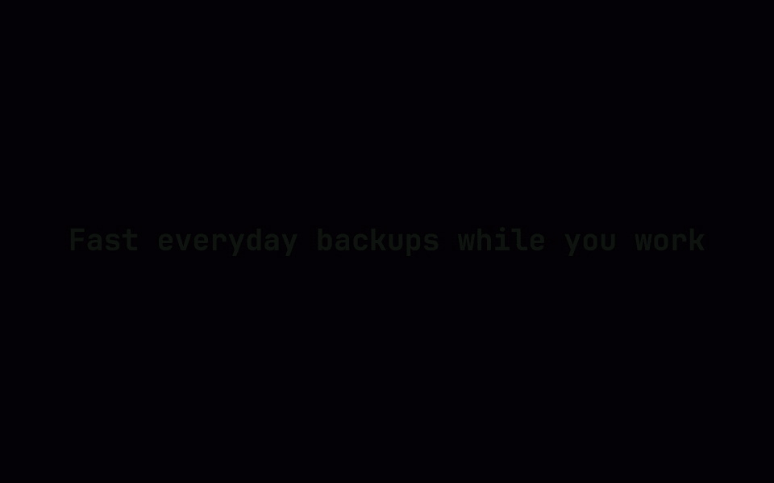
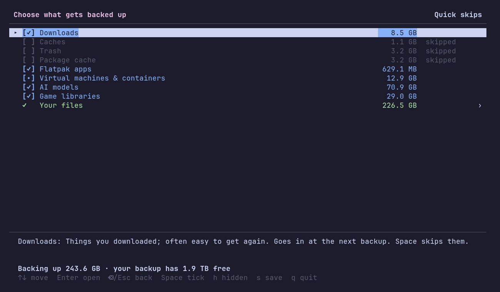
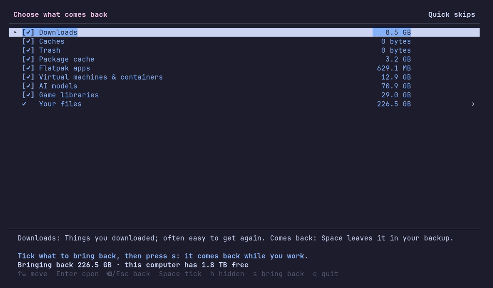

# OmaBackups

**Live incremental backups while you work. Full-system rescue that feels like Time Machine. Migrate to a fresh Omarchy without starting over.**

OmaBackups keeps your Omarchy system safe with fast, automatic backups that run in the background. Because it backs up from btrfs snapshots, your files can change while a backup is running and nothing gets torn. Everyday backups usually take seconds — only what actually changed is sent, and anything already on the backup is reused.

A full unattended rescue puts you back at your desktop exactly as it was. Quick Rescue gets you a working desktop in minutes so you can start working while the rest of your files come back in the background. Migrate lets you do a clean fresh install and still bring over the apps, settings, and tweaks you care about.

Works over Tailscale so you can back up and restore from anywhere. Tested on a Steam Deck and a 2012 MacBook.

---

## Fast everyday backups while you work

Automatic backups every hour (or daily/weekly). Or just hit **Back up now**.

Only changes are sent. A moved or renamed folder is moved on the backup, not uploaded again. Nothing is ever sent twice — data that already exists in an older restore point is reused. Backups run from snapshots so files changing mid-backup can't corrupt anything.

Stop any time. Resume later and it picks up exactly where it left off (already-sent data is skipped in seconds).



*The main window after a backup, then a second incremental run that only has to send a few hundred MB.*

- Encrypted on the backup (LUKS). Unlocked only while in use.
- Works to a backup server (a Raspberry Pi is plenty) or a plugged-in disk.
- Away from home it goes over Tailscale, compressed, and asks before sending something big on a phone hotspot.
- Progress bar shows percent, amount, speed and time remaining. If nothing moves for 3 minutes it tells you.
- Skips quietly when the backup can't be reached, and waits on low battery.
- `omabackups backup --dry-run` shows exactly what a backup would send and delete.

## Choosing what gets backed up

One screen. Quick skips for the big stuff you can get again (Downloads, Caches, Trash, Package cache, Flatpak apps, Virtual machines, AI models, Game libraries) — each showing its size. Your files below, all ticked by default so you can skip anything else.

A skip only drops the bulky data. Program settings, logins and saves stay (Steam keeps your login and Proton saves). Live sizes and a bottom line tell you how much and whether it fits. Colours show what your backup already holds.



## Restore points

Every backup creates a restore point. Smart thinning keeps every one from the last day, one a day for a month, and one a week after that. Keep any forever — kept points show why (★ kept, ★ kept restore, ★ kept migrate).

Open any restore point like a folder in your file manager (read-only). From a terminal or over SSH: `omabackups files` and `omabackups copy`. Delete points or rebuild the working copy from one if you need to repair.

## Getting things back

**Restore my files** brings your folders back while you work. A file that's already here is never touched. After a Quick Rescue it brings back everything that was left behind (AI models and games too), then normal backups carry on.

**Choose what comes back** is the same screen the other way round. Sizes appear immediately because the backup server measures every restore point after each backup.



## The Rescue USB

Brings the whole computer back when it won't start, or onto a new disk. Boots like Omarchy's installer (logo fills as it works).

- **Quick Rescue**: working desktop fast — logged in, apps and settings back. Your files, AI models and games come back after, while you work.
- **Full Rescue**: everything in one go.

Locked with your backup's password (asked once). Finds your backup at home or away over Tailscale (temporary login that removes itself). The restore point it came from is kept until everything's back.

After a Quick Rescue, backups wait until your files are fully back so a half-restored system can never overwrite your good backup (hold Ctrl to back up anyway). One stick at a time — making a new one switches the old one off. Refresh the Rescue USB from the panel when you want a newer image or after a password change.

## Migrate

Your setup onto a fresh Omarchy — even a newer release, even with a new username. Apps, settings, logins, keybindings, bar, theme, fonts, System tweaks. Merged into the new release, not copied over it, and it shows what it changed.

The new computer takes the backup over. The old one's restore points stay (with a Return point). The old computer can keep going too: "Set up a new backup" gives it its own line on the same server, starting from its last restore point, with nothing sent again. Each computer's panel lists its own restore points and the history it carries on from.

## Looking after itself

Nightly health check of the backup disk (a slice a night, standing aside for backups). Damaged files are sent again by name, never reused. Damage twice within three months suggests the disk may be failing.

Notifications (at most once a day): backups paused, no backup for a while, backup nearly full, damage found. Its disks and the Rescue USB never pop open on the desktop.

Remove OmaBackups from Settings — your backup stays unless you choose otherwise (asked twice).

## Under the hood

Plain-language messages everywhere, each with what to do and details you can copy. The backup server runs a small gatekeeper: each computer's key can only do its own fixed set of things; a Rescue USB's key can only read. Works next to OmaBackups 1.x without touching it.

---

**Tested on** a Steam Deck and a 2012 MacBook. Full system restores work to both.

## Install

On Omarchy, in a terminal:

```
omarchy plugin add https://github.com/MattsMacsGit/omabackups.git --enable
```

That puts OmaBackups on your bar. Click its icon (a clock turning back) and press **Install it**: it builds the `omabackups` package from the plugin's own copy, in a terminal window, and asks for your computer's password once. Then set up backups, or Migrate from another computer.

OmaBackups is in the Omarchy plugin store too. It's marked "Manual setup" there because it needs its own system package as well as the panel, so the store sends you here for the steps above.

**Or build it straight from a clone**, two commands:

```
git clone https://github.com/MattsMacsGit/omabackups
```

```
omabackups/packaging/install-edge.sh
```

The first downloads OmaBackups. The second builds and installs it and puts the panel on your bar (it asks for your computer's password once). Then click the OmaBackups icon on the bar (a clock turning back) to set up backups, or to Migrate from another computer.

It needs python, rsync, openssh, cryptsetup, btrfs-progs, polkit, gum and sshfs, all from Arch's own packages (installed with it). Tailscale is optional, for backing up away from home.

**The AUR:** it will be in the AUR too, once the AUR accepts new accounts again (Arch paused them in June 2026 while it cleans up malicious packages).

## Uninstall

Also in the panel: Settings › Your backup › Remove OmaBackups. Or in a terminal, two commands:

```
omabackups remove
```

```
sudo pacman -R omabackups
```

The first takes away its panel, services, snapshots and settings, and asks whether to delete your backup too (twice, because that can't be undone): your backup stays unless you say so. The second removes the package.

Everything else is in [the guide](docs/GUIDE.md).

## Coming from 1.x

2.0 replaces the old 1.x version. Uninstall 1.x first, then install this (above):

```
~/.local/share/oma-backups/uninstall.sh --purge
```

It asks for your computer's password once. When it asks to delete the source folder, say Yes unless you want to keep that copy of 1.x. Your 1.x backups stay where they are (they still open with 1.x's backup password); 2.0 starts a backup of its own, so keep the old one until 2.0's first backup has finished.

Licensed under the MIT License (see [LICENSE](LICENSE)).
